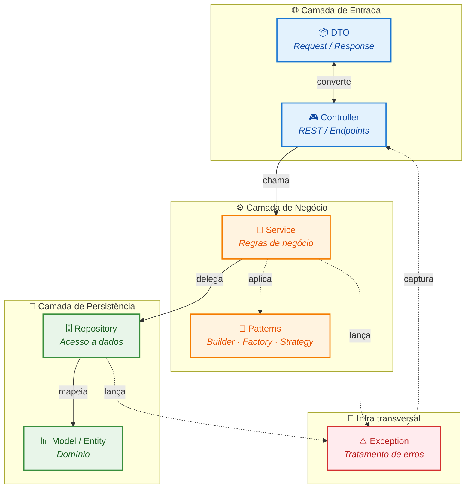
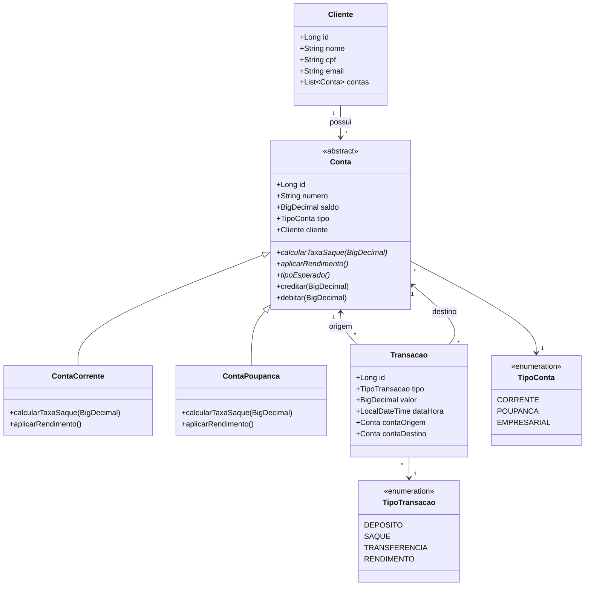

# API-banco-design-patterns


API bancária didática que demonstra a aplicação de **Design Patterns**
clássicos (**Builder**, **Factory Method** e **Strategy**) em um
domínio real, construída com **Java 21**, **Spring Boot 3.3** e
**Maven**.

O foco é mostrar **quando**, **por que** e **como** cada padrão
resolve um problema de design &mdash; sem sacrificar boas práticas de
arquitetura em camadas, documentação (Javadoc em todas as classes),
testes unitários e cobertura ≥ 60% em `pattern/` e `service/`.

---

## Descrição do projeto

Uma API REST de banco com três pilares de domínio:

- **Clientes** &mdash; cadastro único (CPF e e-mail validados);
- **Contas** &mdash; conta corrente (tarifa de saque) e poupança
  (rendimento mensal), ambas abertas via Factory + Builder;
- **Transações** &mdash; depósito, saque e transferência, com regras
  variáveis por tipo de conta delegadas a **Strategies**.

O projeto é **auto-contido**: roda em H2 em memória, sem dependência
externa, e é pensado para **estudo**, **portfólio** e **referência**.

---

## Stack

| Camada | Tecnologia |
|---|---|
| Linguagem | Java 21 |
| Framework | Spring Boot 3.3.5 |
| Persistência | Spring Data JPA + Hibernate |
| Banco (dev/test) | H2 em memória |
| Validação | Jakarta Bean Validation |
| Testes | JUnit 5 + Mockito + AssertJ |
| Cobertura | JaCoCo (check ≥ 60% em `pattern/` e `service/`) |
| Build | Maven |
| Documentação | Javadoc em toda classe pública |

---

## Padrões implementados

### 1. Builder (Criacional)

**Pasta:** [`src/main/java/com/apibanco/pattern/builder/`](src/main/java/com/apibanco/pattern/builder/)

**Problema:** `Conta` possui múltiplos atributos (número, saldo inicial,
cliente, tipo) e regras de criação. Construtores posicionais levariam a
**construtores telescópicos** (`new ContaCorrente(num, saldo, cliente, tipo)`
&mdash; fácil de errar a ordem) e a validações espalhadas.

**Solução:** o **Builder** expõe uma API fluente
(`comNumero(...).comSaldoInicial(...).comCliente(...).build()`) e
**centraliza as validações** no `build()`. O código cliente fica
autoexplicativo; as invariantes de criação ficam em um único lugar.
Subclasses concretas (`ContaCorrenteBuilder`, `ContaPoupancaBuilder`)
usam **self-type genérico** para manter o tipo na cadeia fluente.

**Detalhe do design:** o Builder **não substitui** a entidade &mdash;
ele **produz** a entidade pronta. A entidade permanece "pura" (sem
conhecimento de fluência); o Builder é quem carrega o "como construir".

---

### 2. Factory Method (Criacional)

**Pasta:** [`src/main/java/com/apibanco/pattern/factory/`](src/main/java/com/apibanco/pattern/factory/)

**Problema:** o código cliente não deve conhecer as subclasses concretas
de `Conta` nem saber **qual** instanciar em cada caso. Se amanhã surgir
`ContaEmpresarial`, mudar todos os pontos de `new ContaCorrente()` é
insustentável e viola **OCP** (Open-Closed Principle).

**Solução:** a `ContaFactory` recebe um `TipoConta` e devolve a
subclasse correta, delegando a construção ao **Builder** adequado.
O `switch` expression do Java 21 é **exaustivo** &mdash; se um novo
`TipoConta` for adicionado, o compilador **falha** até tratarmos o caso
(rede de segurança para evolução).

**Detalhe do design:** Factory **orquestra**, Builder **constrói**.
Essa separação de responsabilidades permite evoluir a decisão (Factory)
independentemente das regras de construção (Builder).

---

### 3. Strategy (Comportamental)

**Pasta:** [`src/main/java/com/apibanco/pattern/strategy/`](src/main/java/com/apibanco/pattern/strategy/)

**Problema:** a **tarifa de saque** e a **existência de rendimento**
variam por tipo de conta. Sem Strategy, cada novo tipo exigiria `if/else`
espalhados por `TransacaoService` &mdash; e a cada nova operação (ex.:
saque especial, PIX) o `if/else` cresceria em complexidade combinatória.

**Solução:** cada **comportamento variável** vira uma **Strategy**
(`SaqueStrategy`, `RendimentoStrategy`). O `TransacaoService` recebe
`List<OperacaoStrategy>` do Spring e monta `Map<TipoConta, Strategy>`.
O tipo da conta **roteia** para a Strategy certa &mdash; **nenhum
`instanceof`** em runtime.

**Detalhe do design:** a spec original propunha uma interface única com
`executar(valor, conta)`. Optamos por **sub-interfaces específicas**
(`SaqueStrategy`, `RendimentoStrategy`) porque "saque" e "rendimento"
têm contratos e efeitos colaterais diferentes. Forçar as duas no mesmo
`executar` geraria ambiguidade (retorna a taxa? o novo saldo?).

---

## Arquitetura em camadas

O projeto segue o padrão **Layer-based** clássico:

```mermaid
flowchart TD
    Client[Cliente HTTP] -->|JSON| Ctrl[Controller<br/>@RestController]
    Ctrl -->|DTO validado| Svc[Service<br/>@Service + @Transactional]
    Svc -->|Entidades| Repo[Repository<br/>Spring Data JPA]
    Repo -->|SQL| DB[(H2<br/>em memória)]
    Svc -->|Usa| Pat[Pattern<br/>Builder / Factory / Strategy]
    Svc -->|Lança| Exc[Exception<br/>BusinessException<br/>NotFoundException]
    Exc -.->|Traduz para HTTP| Handler[GlobalExceptionHandler<br/>@RestControllerAdvice]
    Handler -.->|JSON padronizado| Client

    Ctrl -.->|Nunca acessa| Repo
    Svc -.->|Retorna| Ctrl
```

## Regras de ouro

1. `Controller` nunca acessa `Repositorio` diretamente, toda regra passa pelo `Service`.
2. Nenhuma entidade sai do `Service` como entidade crua para o cliente, o `Controller` converte para DTO(`.from(...)`).
3. `Repository` só é injetado em `Service`, exceto para testes.
4. Exceptions de domínio(`BusinessException`, `NotFoundException`) são capturadas pelo `@RestControllerAdvice` global, o `Controller` não faz `try/catch`.

## Mapa de dependências entre módulos



## Diagrama de classes UML



## Endpoints

### Clientes

| Método | Path | Request | Response | Status |
|:---:|:---|:---|:---|:---|
|  | `/api/clientes` | `ClienteRequest` | `ClienteResponse` |  + `Location` |
|  | `/api/clientes/{id}` | — | `ClienteResponse` |  ·  |
|  | `/api/clientes` | — | `List<ClienteResponse>` |  |

### ClienteRequest

```json
{
  "nome": "João da Silva",
  "cpf": "12345678900",
  "email": "joao.silva@email.com"
}
```

| Campo | Tipo | Obrigatório | Validação |
|---|:---:|:---:|---|
| `nome` | `String` | ✅ | `@NotBlank`, `@Size(max = 120)` |
| `cpf` | `String` | ✅ | `@NotBlank`, `@Pattern(\d{11})`  11 dígitos numéricos, **sem pontuação** |
| `email` | `String` | ✅ | `@NotBlank`, `@Email`, `@Size(max = 180)` |

### ClienteResponse

```json
{
  "id": 1,
  "nome": "João da Silva",
  "cpf": "12345678900",
  "email": "joao.silva@email.com"
}
```

### Contas

| Método | Path | Request | Response | Status |
|:---:|:---|:---|:---|:---|
|  | `/api/contas` | `ContaRequest` | `ContaResponse` |  + `Location` |
|  | `/api/contas/{id}` | — | `ContaResponse` |  ·  |
|  | `/api/contas/{id}/extrato` | — | `List<TransacaoResponse>` |  ·  |

### ContaRequest

```json
{
  "clienteId": 1,
  "tipo": "CORRENTE",
  "saldoInicial": 500.00
}
```

| Campo | Tipo | Obrigatório | Validação |
|---|:---:|:---:|---|
| `clienteId` | `Long` | ✅ | `@NotNull`, deve existir |
| `tipo` | `TipoConta` | ✅ | `@NotNull` — `CORRENTE` \| `POUPANCA` \| `EMPRESARIAL` |
| `saldoInicial` | `BigDecimal` | ✅ | `@NotNull`, `@DecimalMin("0")` |

### ContaResponse

```json
{
  "id": 10,
  "numero": "000123-4",
  "saldo": 1500.00,
  "tipo": "CORRENTE",
  "clienteId": 1,
  "clienteNome": "João da Silva"
}
```

### Extrato — List<TransacaoResponse>

```json
[
  {
    "id": 100,
    "tipo": "DEPOSITO",
    "valor": 500.00,
    "dataHora": "2026-11-05T10:15:30",
    "contaOrigemId": null,
    "contaDestinoId": 10
  },
  {
    "id": 101,
    "tipo": "SAQUE",
    "valor": 100.00,
    "dataHora": "2026-11-05T11:02:11",
    "contaOrigemId": 10,
    "contaDestinoId": null
  }
]
```

### Transações

| Método | Path | Request | Response | Status |
|:---:|:---|:---|:---|:---|
|  | `/api/transacoes/deposito` | `DepositoRequest` | `TransacaoResponse` |  |
|  | `/api/transacoes/saque` | `SaqueRequest` | `TransacaoResponse` |  |
|  | `/api/transacoes/transferencia` | `TransferenciaRequest` | `TransacaoResponse` |  |

### DepositoRequest

```json
{
  "contaDestinoId": 10,
  "valor": 500.00
}
```

| Campo | Tipo | Obrigatório | Validação |
|---|:---:|:---:|---|
| `contaDestinoId` | `Long` | ✅ | `@NotNull`, conta deve existir |
| `valor` | `BigDecimal` | ✅ | `@NotNull`, `@DecimalMin("0.01")`  estritamente positivo |

### 📥 SaqueRequest

```json
{
  "contaOrigemId": 10,
  "valor": 100.00
}
```

| Campo | Tipo | Obrigatório | Validação |
|---|:---:|:---:|---|
| `contaOrigemId` | `Long` | ✅ | `@NotNull`, conta deve existir |
| `valor` | `BigDecimal` | ✅ | `@NotNull`, `@DecimalMin("0.01")`  estritamente positivo |

> ⚠️ O valor do saque é **acrescido da taxa** calculada por `calcularTaxaSaque()`.

### TransferenciaRequest

```json
{
  "contaOrigemId": 10,
  "contaDestinoId": 20,
  "valor": 250.00
}
```

| Campo | Tipo | Obrigatório | Validação |
|---|:---:|:---:|---|
| `contaOrigemId` | `Long` | ✅ | `@NotNull`, ≠ `contaDestinoId` |
| `contaDestinoId` | `Long` | ✅ | `@NotNull`, conta deve existir |
| `valor` | `BigDecimal` | ✅ | `@NotNull`, `@DecimalMin("0.01")`  estritamente positivo |

### TransacaoResponse

```json
{
  "id": 102,
  "tipo": "TRANSFERENCIA",
  "valor": 250.00,
  "dataHora": "2026-11-05T14:33:00",
  "contaOrigemId": 10,
  "contaDestinoId": 20
}
```

## Corpo de erro (padronizado)

Todas as respostas **4xx** e **5xx** seguem o mesmo formato:

```json
{
  "erro": "regra de negócio violada",
  "mensagem": "saldo insuficiente para saque: precisa de 50,50, mas há 50,00",
  "timestamp": "2026-11-05T13:43:55.108"
}
```

| Campo | Tipo | Descrição |
|---|---|---|
| `erro` | `String` | Categoria curta do erro (ex.: `regra de negócio violada`) |
| `mensagem` | `String` | Detalhe legível do que aconteceu |
| `timestamp` | `LocalDateTime` | Momento do erro (formato ISO-8601) |

### Erros de validação (`@Valid`)

Quando a falha vem da validação de campos, o corpo **adiciona** o campo `campos`:

```json
{
  "erro": "validação falhou",
  "mensagem": "um ou mais campos inválidos",
  "timestamp": "2026-11-05T13:43:55.108",
  "campos": {
    "cpf": "cpf deve conter exatamente 11 dígitos numéricos"
  }
}
```

| Campo | Tipo | Descrição |
|---|---|---|
| `campos` | `Map<String, String>` | Nome do campo → mensagem de erro |

## 🚀 Como executar

### Pré-requisitos

- Java 21+
- Maven 3.9+

### Rodar a aplicação

```bash
mvn clean install
mvn spring-boot:run
```

A API sobe em **http://localhost:8080**.

### Console H2

Acesse **http://localhost:8080/h2-console** e preencha:

| Campo | Valor |
|---|---|
| Driver Class | `org.h2.Driver` |
| JDBC URL | `jdbc:h2:mem:bancodb` |
| User Name | `sa` |
| Password | _(vazio)_ |

Clique em **Connect** para inspecionar as tabelas `cliente`, `conta` e `transacao` criadas pelo Hibernate.

### Rodar o JAR gerado

```bash
mvn clean package
java -jar target/api-banco-design-patterns-0.0.1-SNAPSHOT.jar
```

## 🧪 Como rodar testes

### Executar todos os testes

```bash
mvn test
```

Executa todos os testes unitários (**JUnit 5 + Mockito + AssertJ**).

### Cobertura (JaCoCo)

```bash
mvn clean verify
```

Roda os testes e o **check de cobertura**: se `pattern/` ou `service/` ficar abaixo de **60% de linhas cobertas**, o build **falha** com:

```text
Rule violated for package ...
```

Relatório HTML gerado após o `verify`:

```text
target/site/jacoco/index.html
```

### Rodar apenas uma classe de teste

```bash
mvn test -Dtest=ContaBuilderTest
```

## 👤 Autor & Contexto DIO

**Autor:** Douglas Lira

**Contexto:** este projeto foi construído como parte do bootcamp da [DIO](https://www.dio.me/) — uma jornada de aprendizado prático em **Java + Spring Boot** com foco em **Design Patterns** aplicados a um domínio real.

**Objetivo didático:** servir de referência para quem quer ver os patterns em uso, com documentação detalhada (Javadoc em todas as classes), testes cobrindo os fluxos e uma arquitetura em camadas sólida.

### 🛠️ Sugestões de evolução

- [ ] Substituir **H2** por **PostgreSQL + Flyway**
- [ ] Adicionar autenticação (**Spring Security + JWT**)
- [ ] Adicionar observabilidade (**Micrometer + Actuator**)
- [ ] Expor documentação **OpenAPI/Swagger** (`springdoc-openapi`)
- [ ] Adicionar testes de integração (`@SpringBootTest`)
  
## 📄 Licença

**MIT** — fique à vontade para usar como referência de estudo.

Veja o arquivo [LICENSE](./LICENSE) para o texto completo.